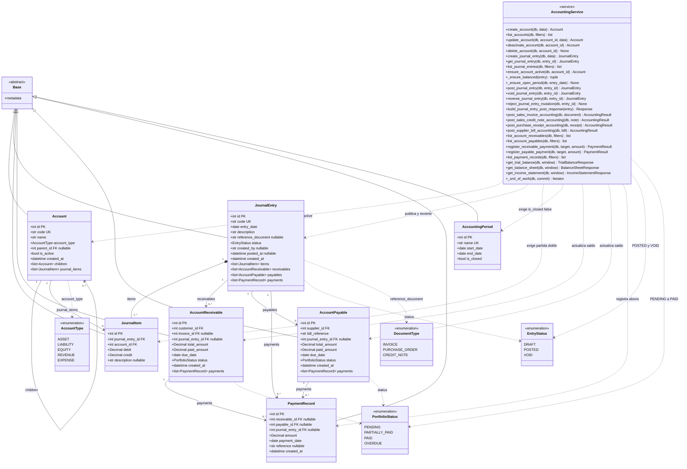
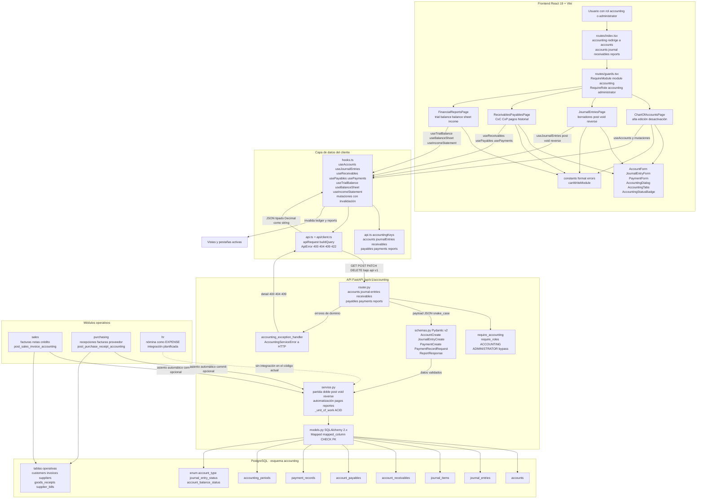
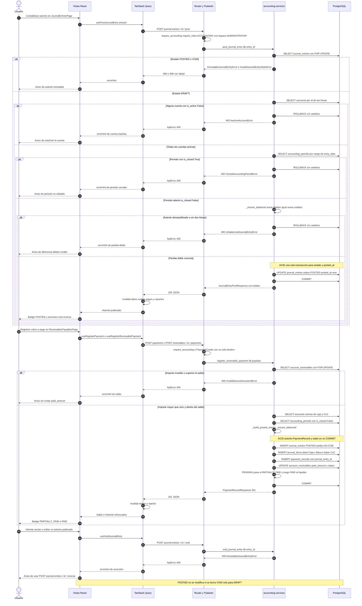

# Diagramas técnicos — Módulo `accounting`

Documentación visual del módulo de Finanzas y Contabilidad, derivada de
`specs/accounting_spec.md`, del apéndice `APEND_PROJECT_MANIFIEST.md` (hito 10) y
del código final de `backend/src/modules/accounting/` y
`frontend/src/modules/accounting/`.

| Diagrama | Qué responde |
| --- | --- |
| Clases | Qué entidades SQLAlchemy existen, sus enums, relaciones y servicios de dominio |
| Componentes | Cómo viaja una petición desde React y TanStack Query hasta PostgreSQL y los módulos operativos |
| Secuencia | Qué ocurre al contabilizar un asiento o al registrar un cobro o pago |

> **Convención de nombres.** La spec y el apéndice usan `EntryStatus`,
> `DocumentType` y `PortfolioStatus`. En el código se materializan como
> `JournalEntryStatus`, `reference_document` con prefijos automáticos y
> `AccountBalanceStatus`, respectivamente. El diagrama conserva los nombres
> solicitados y esta sección los mapea al contrato real.

---

## 1. Diagrama de clases

Entidades SQLAlchemy de `models.py`, enums de estado/tipo, cardinalidades y los
métodos clave de `service.py`. `Decimal` significa `Numeric(14, 2)` en
PostgreSQL y viaja como cadena en la API.

### Reglas reflejadas en el modelo

- `Account.parent_id` es autorreferencial con `ON DELETE RESTRICT`: una cuenta
  con subcuentas o movimientos no se elimina, solo se desactiva con
  `is_active = False`.
- `JournalEntry.items` usa `CASCADE`; las líneas dependen del comprobante. El
  resto de las claves foráneas financieras usan `RESTRICT` para conservar
  historial.
- `JournalItem` garantiza en base de datos `debit >= 0`, `credit >= 0` y
  `NOT (debit > 0 AND credit > 0)`. El equilibrio exacto y el mínimo de dos
  líneas se validan en `post_journal_entry`.
- `POSTED` es inmutable: `void_journal_entry` solo pasa `DRAFT` a `VOID`; un
  asiento publicado se corrige con `reverse_journal_entry`, que crea un
  comprobante `REV-YYYY-XXXX` nuevo con débitos y créditos invertidos.
- `PortfolioStatus` es el mismo enum para CxC y CxP. `OVERDUE` se fija en la
  cartera y se conserva en abonos parciales mientras quede saldo.
- `DocumentType` es el tipo conceptual de la spec (`INVOICE`,
  `PURCHASE_ORDER`, `CREDIT_NOTE`). No existe como enum nativo: la procedencia
  se guarda en `reference_document` y se distingue con los prefijos
  `ASI-FAC`, `ASI-NC`, `ASI-REC`, `ASI-FCP`, `ASI-COB` y `ASI-PAG`.
- `AccountingPeriod` no tiene FK: `post_journal_entry` y los pagos comprueban
  por rango de fechas que no exista un periodo con `is_closed = True`.
- Los reportes solo leen asientos `POSTED` mediante `_posted_account_totals`;
  `DRAFT` y `VOID` no afectan saldos ni estados financieros.

---

## 2. Diagrama de componentes

Arquitectura full-stack: vistas React → guardias RBAC → hooks de TanStack Query
y cliente HTTP → routers, esquemas y servicios de FastAPI → tablas PostgreSQL,
con la automatización contable de los módulos operativos.

### Lectura del diagrama

- **Doble guardia RBAC.** `RequireModule` valida `allowed_modules` y
  `RequireRole` exige `accounting` o `administrator`, reflejando
  `require_roles([RoleEnum.ACCOUNTING])` con bypass de administrador en el
  backend.
- **Una sola capa de datos.** Las vistas no llaman a `fetch`: consumen
  `hooks.ts`, que delega en `api.ts` y comparte `accountingKeys` para invalidar
  diario, cartera, pagos y reportes tras cada mutación.
- **Solo la pestaña activa consulta.** `ReceivablesPayablesPage` y
  `FinancialReportsPage` pasan `enabled` a los hooks para no lanzar peticiones
  innecesarias.
- **Integración real y planificada.** `sales` y `purchasing` llaman a los
  servicios automáticos con `commit=False` opcional; `hr` aparece con trazo
  discontinuo porque el módulo aún no existe en el código actual y solo está
  previsto como futuro origen de asientos de nómina.
- **ACID en el servicio.** `_unit_of_work` y `_atomic` agrupan asiento,
  `PaymentRecord` y saldo de cartera en un único `COMMIT`, con `ROLLBACK`
  automático ante cualquier excepción de dominio.

---

## 3. Diagrama de secuencia — contabilización y registro de cobros o pagos

Flujo completo para `POST /journal-entries/{id}/post` (en la spec
`/entries/{id}/post`) y `POST /payments`. Incluye partida doble, cuentas activas,
periodo abierto, transacción ACID, transición de cartera e inmutabilidad.

### Puntos críticos del flujo

- **Orden de validación.** Estado del asiento, cuentas `is_active`,
  `is_closed = False` del periodo y equilibrio débito/crédito. Cualquier fallo
  ocurre antes del `COMMIT`, por lo que no quedan filas parciales.
- **Bloqueo optimista/pesimista.** `get_journal_entry(..., for_update=True)` y
  `SELECT ... FOR UPDATE` sobre la cartera serializan publicaciones y abonos.
- **Pago atómico.** El asiento `ASI-COB`/`ASI-PAG`, el `PaymentRecord` y el
  `paid_amount` se confirman juntos; si falla `_apply_payment_to_balance`, el
  `ROLLBACK` elimina los tres efectos.
- **Transición de cartera.** `PENDING → PARTIALLY_PAID` mientras quede saldo y
  `PAID` cuando `paid_amount = total_amount`; `OVERDUE` se conserva si ya estaba
  fijado y aún hay deuda.
- **Inmutabilidad.** No existen `PATCH`/`DELETE` HTTP para asientos; los
  listeners ORM `before_update`/`before_delete` son la segunda capa de defensa.
- **Coherencia de caché.** Publicar o pagar invalida simultáneamente diario,
  CxC, CxP, historial de pagos y los tres reportes, que solo leen `POSTED`.
