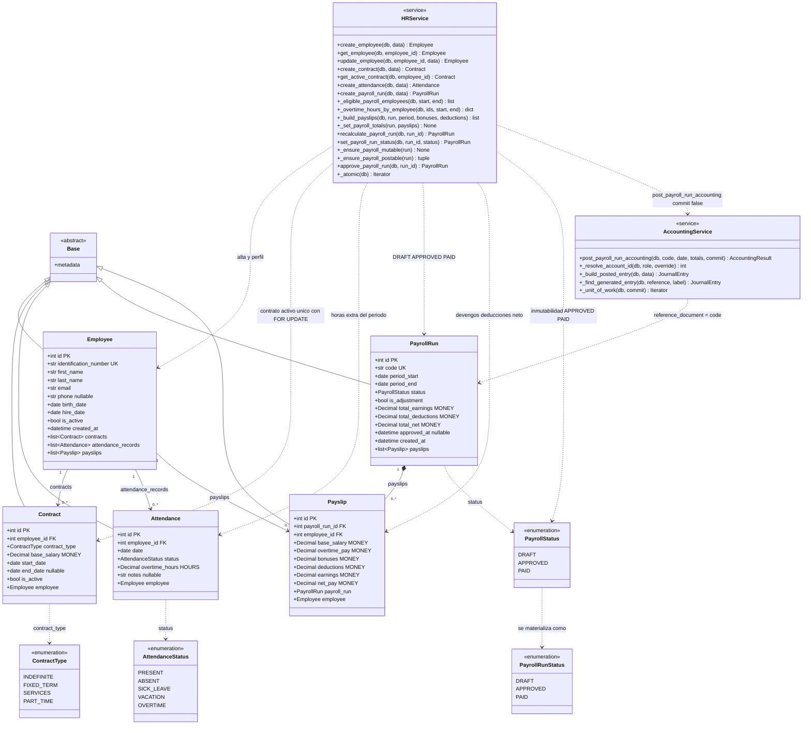
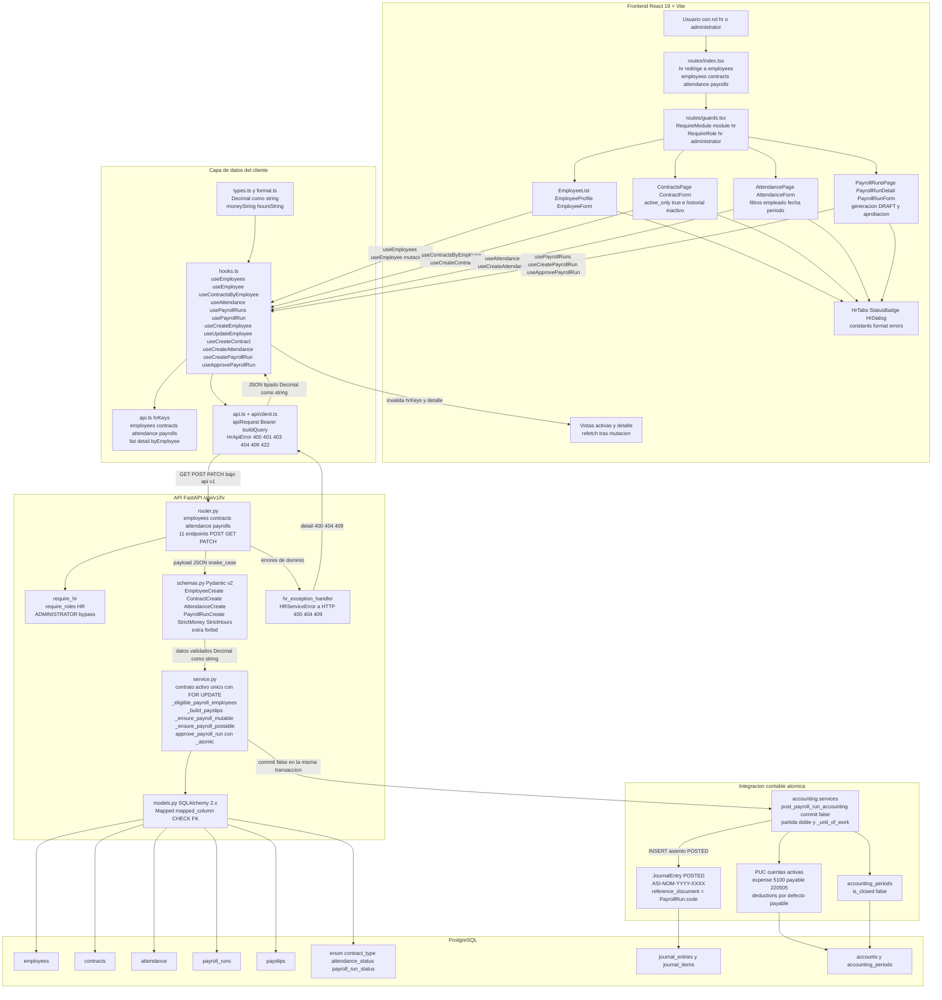
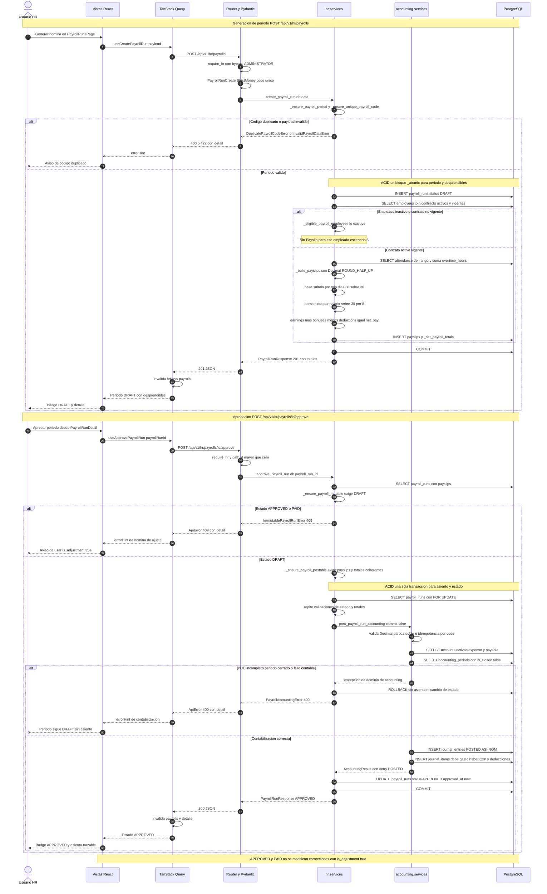

# Diagramas técnicos — Módulo `hr`

Documentación visual del módulo de Recursos Humanos y Nómina, derivada de
`specs/hr_spec.md`, de `PROJECT_MANIFEST.md` (rol RBAC `HR`) y del código final
de `backend/src/modules/hr/`, `backend/src/modules/accounting/service.py` y
`frontend/src/modules/hr/`.

| Diagrama | Qué responde |
| --- | --- |
| Clases | Qué entidades SQLAlchemy existen, sus enums, relaciones y servicios de dominio |
| Componentes | Cómo viaja una petición desde React y TanStack Query hasta PostgreSQL y la contabilización atómica |
| Secuencia | Qué ocurre al generar un periodo de nómina y al aprobarlo con asiento contable |

> **Convención de nombres.** La spec usa `PayrollStatus` para el ciclo
> `DRAFT`/`APPROVED`/`PAID`. En el código se materializa como `PayrollRunStatus`
> (enum nativo `payroll_run_status`). El diagrama conserva el nombre solicitado
> y muestra el mapeo al contrato real, igual que `docs/accounting_diagrams.md`.
> La regla 5 de la spec nombra los roles `HR` y `ADMINISTRATOR`; en el router se
> declara `require_hr = require_roles([RoleEnum.HR])` y el administrador entra
> por el *bypass* de superusuario de `core/security.py`.

---

## 1. Diagrama de clases

Entidades SQLAlchemy de `models.py`, enums de estado/tipo, cardinalidades y los
métodos clave de `service.py`. `Decimal` significa `Numeric(14, 2)` (`MONEY`) o
`Numeric(7, 2)` (`HOURS`) en PostgreSQL y viaja como cadena en la API.

### Reglas reflejadas en el modelo

- **Contrato activo único.** `create_contract` bloquea la fila del empleado con
  `SELECT ... FOR UPDATE` y rechaza un segundo contrato vigente con
  `ActiveContractError` (400). `_find_active_contract` y `get_active_contract`
  son la base del cálculo de nómina.
- **Cálculo exacto.** `_build_payslips` usa solo `Decimal` con
  `ROUND_HALF_UP`: `base_salary = salario * min(días_del_periodo, 30) / 30`,
  `overtime_pay = horas_extra * salario / (30 * 8)`,
  `earnings = base_salary + overtime_pay + bonuses` y
  `net_pay = earnings - deductions`. `_set_payroll_totals` suma los importes ya
  cuantizados, por lo que los totales del encabezado coinciden con los
  desprendibles.
- **Empleados elegibles.** `_eligible_payroll_employees` exige
  `Employee.is_active = True` y `Contract.is_active = True` con
  `start_date <= period_end` y (`end_date IS NULL` o `end_date >= period_start`).
  Las horas extra se suman de `Attendance` del rango con
  `_overtime_hours_by_employee`.
- **Inmutabilidad.** `_ensure_payroll_mutable` lanza
  `ImmutablePayrollRunError` (409) en `APPROVED`/`PAID` antes de recalcular,
  cambiar el estado o aprobar. La corrección exige un nuevo `PayrollRun` con
  `is_adjustment = True`. `set_payroll_run_status` solo permite `DRAFT → PAID`.
- **Aprobación contable.** `approve_payroll_run` valida con
  `_ensure_payroll_postable` (desprendibles, devengado positivo y totales
  coherentes) y llama a `post_payroll_run_accounting(..., commit=False)`, de modo
  que asiento y cambio de estado comparten una sola unidad de trabajo.
- **Integridad en base de datos.** `identification_number` y `code` son únicos;
  `Payslip` es único por `(payroll_run_id, employee_id)`. Las FK usan
  `RESTRICT` salvo `payroll_runs → payslips`, que usa `CASCADE`. Los `CHECK`
  garantizan fechas coherentes, importes no negativos y
  `net_pay = earnings - deductions` / `total_net = total_earnings - total_deductions`.

---

## 2. Diagrama de componentes

Arquitectura full-stack: vistas React → guardias RBAC → hooks de TanStack Query
y cliente HTTP → routers, esquemas y servicios de FastAPI → tablas PostgreSQL,
con la integración contable atómica en `accounting`.

### Lectura del diagrama

- **Doble guardia RBAC.** `RequireModule module="hr"` valida
  `allowed_modules` y `RequireRole roles={["hr","administrator"]}` refleja
  `require_hr = require_roles([RoleEnum.HR])` con bypass de administrador en el
  backend. Sin token, `apiRequest` recibe 401; con otro rol, 403.
- **Una sola capa de datos.** Ninguna vista llama a `fetch`: consumen
  `hooks.ts`, que delega en `api.ts` y comparte `hrKeys` para invalidar
  empleados, contratos, asistencia y nómina tras cada mutación.
- **Decimales como cadena.** `types.ts` y `format.ts` normalizan importes y horas
  con `moneyString`/`hoursString`; `StrictMoney`/`StrictHours` rechazan `float`
  con 422 y `extra="forbid"` bloquea campos no declarados.
- **Autoridad en el servidor.** El formulario de contratos consulta
  `active_only=true` para avisar de un contrato vigente, pero es
  `create_contract` con `FOR UPDATE` quien impide el segundo activo (400).
- **Integración real, no planificada.** A diferencia del diagrama de
  `accounting`, aquí `hr → accounting` es una arista sólida:
  `post_payroll_run_accounting(..., commit=False)` se ejecuta dentro de la
  transacción de RRHH, con cuentas activas y periodo abierto.
- **ACID en el servicio.** `hr._atomic` agrupa el `PayrollRun`, sus `Payslip` y
  el asiento `ASI-NOM`; `accounting._unit_of_work` no hace `COMMIT` propio cuando
  recibe `commit=False`. Cualquier excepción produce `ROLLBACK` completo.

---

## 3. Diagrama de secuencia — generación y aprobación de nómina

Flujo completo para `POST /api/v1/hr/payrolls` y
`POST /api/v1/hr/payrolls/{id}/approve`. Incluye contrato activo, cálculo de
`Payslip`, inmutabilidad de `APPROVED`/`PAID`, transacción ACID, asiento
contable y rollback ante fallo.

### Puntos críticos del flujo

- **Orden de validación.** Periodo y código antes de insertar; elegibilidad del
  contrato antes de calcular; estado mutable y totales coherentes antes de
  contabilizar. Ningún fallo deja filas parciales.
- **Elegibilidad real.** Se excluyen empleados inactivos, sin contrato activo o
  con contrato que no cubre el periodo (escenario 6). Las horas extra se leen de
  `Attendance` dentro del rango, no solo de registros `OVERTIME`.
- **Bloqueo y revalidación.** La aprobación vuelve a leer con
  `SELECT ... FOR UPDATE` y repite `_ensure_payroll_mutable` y
  `_ensure_payroll_postable`, evitando aprobaciones concurrentes o basadas en
  datos modificados entre lectura y bloqueo.
- **Asiento trazable.** `post_payroll_run_accounting` debita la cuenta `expense`
  por el devengado y acredita `payable` por el neto y, si hay, la cuenta de
  deducciones. Usa `ASI-NOM-YYYY-XXXX`, `reference_document = PayrollRun.code`,
  `entry_date = period_end` y es idempotente por ese código.
- **Rollback atómico.** Con `commit=False`, `hr._atomic` confirma asiento y
  estado juntos; si falla la contabilización (PUC incompleto, periodo cerrado o
  partida descuadrada), `ROLLBACK` y `PayrollAccountingError` (400) dejan el
  periodo en `DRAFT` sin asiento, permitiendo reintentar.
- **Inmutabilidad.** Reaprobar o intentar recalcular/cambiar el estado en
  `APPROVED`/`PAID` responde 409; la corrección es un nuevo periodo con
  `is_adjustment = True`.
- **Coherencia de caché.** Generar y aprobar invalidan `hrKeys.payrolls` y el
  detalle del periodo, de modo que la interfaz refleja el nuevo estado y los
  desprendibles sin recargar la página.
