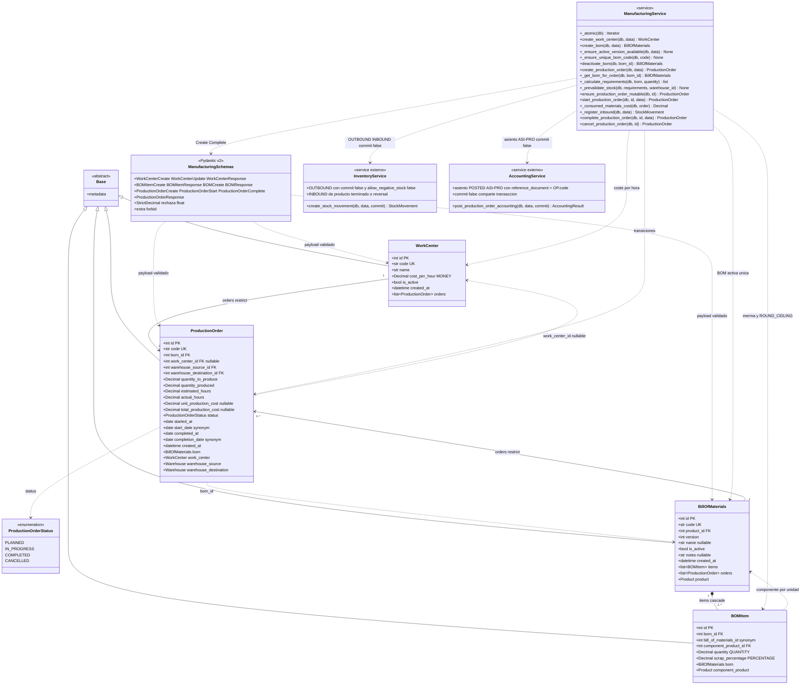
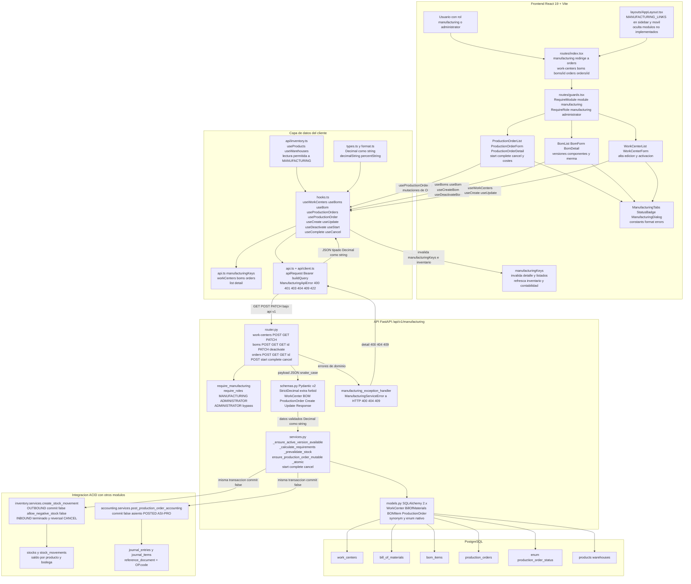

# Diagramas técnicos — Módulo `manufacturing`

Documentación visual del módulo de Manufactura y Producción, derivada de
`specs/manufacturing_spec.md`, de `PROJECT_MANIFEST.md` (rol RBAC
`MANUFACTURING`) y del código final de `backend/src/modules/manufacturing/`,
`backend/src/modules/inventory/`, `backend/src/modules/accounting/service.py` y
`frontend/src/modules/manufacturing/`.

| Diagrama | Qué responde |
| --- | --- |
| Clases | Qué entidades SQLAlchemy existen, sus enums, relaciones y servicios de dominio |
| Componentes | Cómo viaja una petición desde React y TanStack Query hasta PostgreSQL, con consumo de inventario y asiento contable en la misma transacción |
| Secuencia | Qué ocurre al crear, iniciar, completar y cancelar una orden de producción, incluidos déficit de stock y rollback ACID |

> **Convención de nombres.** La spec usa `bill_of_materials_id`, `start_date` y
> `completion_date`; el contrato canónico del código usa `bom_id`, `started_at`
> y `completed_at`. Los nombres de la spec se conservan como `synonym()` en los
> modelos ORM (no generan columnas DDL). El enum `ProductionOrderStatus` es el
> nativo `production_order_status` con `PLANNED`/`IN_PROGRESS`/`COMPLETED`/
> `CANCELLED`. La regla 7 nombra los roles `MANUFACTURING` y `ADMINISTRATOR`;
> el router declara `require_manufacturing = require_roles([MANUFACTURING,
> ADMINISTRATOR])` y el administrador además entra por el *bypass* de
> superusuario de `core/security.py`.

---

## 1. Diagrama de clases

Entidades SQLAlchemy de `models.py`, esquemas Pydantic v2 de `schemas.py`,
servicios de `services.py` y las integraciones reales con `inventory` y
`accounting`. `Decimal` significa `Numeric(14,2)` (`MONEY`/`QUANTITY`),
`Numeric(7,2)` (`HOURS`) o `Numeric(5,2)` (`PERCENTAGE`) en PostgreSQL y viaja
como cadena en la API.

### Reglas reflejadas en el modelo

- **Receta vigente única.** `create_bom`/`update_bom` bloquean la fila del
  producto con `FOR UPDATE` y validan con `_ensure_active_version_available`
  que no exista otra BOM activa para el mismo `(product_id, version)`; el
  código es único de forma global. Las infracciones son 409.
- **Cálculo exacto.** `_calculate_requirements` aplica por línea
  `cantidad * (1 + merma/100) * cantidad_a_producir` con `Decimal` y redondea
  cada componente hacia arriba (`ROUND_CEILING`) a un entero, con mínimo 1.
  Nunca se usan `float`: `StrictDecimal` rechaza JSON con decimales binarios
  (422) y los esquemas declaran `extra="forbid"`.
- **Stock antes de escribir.** `_prevalidate_stock` informa SKU, disponible,
  requerido y déficit (400) antes de registrar cualquier `OUTBOUND`. Los
  movimientos se crean con `commit=False` y `allow_negative_stock=False`, de
  modo que un déficit imprevisto revierte toda la transacción.
- **Coste desde consumos reales.** `_consumed_materials_cost` suma los
  `OUTBOUND` de la orden (precio al momento del consumo); se añade
  `actual_hours * cost_per_hour` del centro y se cuantiza con `ROUND_HALF_UP`.
  El coste unitario es `total / quantity_produced`.
- **Transiciones.** Solo `PLANNED → IN_PROGRESS → COMPLETED`, con cancelación
  desde `PLANNED` o `IN_PROGRESS`. `ensure_production_order_mutable` bloquea la
  OP con `SELECT ... FOR UPDATE`; `COMPLETED`/`CANCELLED` son inmutables (409).
- **Reversión por cancelación.** Si la OP estaba en curso, se registran
  `INBOUND` en la bodega de origen con `reference_document =
  "{code}-CANCEL"`, uno por cada `OUTBOUND`, en la misma transacción que el
  cambio a `CANCELLED`.
- **Asiento trazable.** `_post_completion_accounting` llama a
  `post_production_order_accounting(..., commit=False)`, que genera un
  `JournalEntry` `POSTED` con prefijo `ASI-PRO`, `reference_document =
  OP.code` y las cuentas de producto terminado, materiales y mano de obra. La
  orden, el inventario y la contabilidad comparten un único `COMMIT`.

---

## 2. Diagrama de componentes

Arquitectura full-stack: vistas React → guardias RBAC → hooks de TanStack Query
y cliente HTTP → routers, esquemas y servicios de FastAPI → tablas PostgreSQL,
con integración atómica en `inventory` y `accounting`.

### Lectura del diagrama

- **Doble guardia RBAC.** `RequireModule module="manufacturing"` valida
  `allowed_modules` y `RequireRole roles={["manufacturing",
  "administrator"]}` refleja `require_manufacturing`. El backend es la
  autoridad real: sin token devuelve 401 y con otros roles 403, aunque el
  frontend oculte los enlaces.
- **Catálogos compartidos.** El formulario de BOM consulta `useProducts` y el
  de OP `useWarehouses`. `MANUFACTURING` tiene permiso de lectura de inventario
  en el backend, pero no de escritura; las existencias solo cambian mediante
  las transiciones de la orden.
- **Una sola capa de datos.** Ninguna vista llama a `fetch`: consumen
  `hooks.ts`, que delega en `api.ts` y comparte `manufacturingKeys` para
  invalidar listados y detalle tras cada mutación.
- **Decimales como cadena.** `types.ts` y `format.ts` envían `decimalString` y
  `percentString`, nunca `number`. `StrictDecimal` rechaza `float` con 422 y
  `extra="forbid"` bloquea campos controlados por el servidor (`status`,
  costes, fechas de transición).
- **ACID de extremo a extremo.** `services._atomic` agrupa la orden, los
  movimientos de `inventory` y el asiento de `accounting`; ambos servicios
  reciben `commit=False`. Un fallo en cualquier paso produce `ROLLBACK`
  completo: ni descuentos parciales, ni asiento huérfano, ni cambio de estado.
- **Coherencia de caché.** `refreshOrderViews` actualiza el detalle y
  invalida órdenes, movimientos, existencias y asientos, de modo que la UI
  refleje los saldos y costes calculados en el servidor sin recargar.

---

## 3. Diagrama de secuencia — ciclo de vida de una orden

Flujo completo para `POST /orders`, `POST /orders/{id}/start`,
`POST /orders/{id}/complete` y `POST /orders/{id}/cancel`. Incluye validación de
BOM activa, déficit de stock, costes, asiento contable, reversión y rollback.

```mermaid
sequenceDiagram
    autonumber
    actor Op as Usuario Manufactura
    participant UI as Vistas React
    participant Q as TanStack Query
    participant R as Router y Pydantic
    participant S as manufacturing.services
    participant I as inventory.services
    participant A as accounting.services
    participant DB as PostgreSQL

    Note over Op,DB: Alta POST /api/v1/manufacturing/orders

    Op->>UI: Nueva orden en ProductionOrderForm
    UI->>Q: useCreateProductionOrder payload
    Q->>R: POST /orders
    R->>R: require_manufacturing con bypass ADMINISTRATOR
    R->>R: ProductionOrderCreate StrictDecimal extra forbid
    R->>S: create_production_order db data
    S->>DB: SELECT bill_of_materials FOR UPDATE
    alt BOM inactiva o inexistente
        S--xR: InactiveBOMError o ResourceNotFoundError
        R--xQ: 400 o 404 con detail
        Q--xUI: errorHint de receta vigente
        UI--xOp: Aviso de seleccionar otra BOM
    else BOM vigente
        S->>S: valida bodegas distintas cantidad y horas
        S->>DB: INSERT production_orders status PLANNED
        S->>DB: COMMIT
        S-->>R: ProductionOrderResponse 201
        Q->>Q: invalida manufacturingKeys orders
        UI-->>Op: Badge Planificada
    end

    Note over Op,DB: Inicio POST /api/v1/manufacturing/orders/id/start

    Op->>UI: Iniciar orden desde ProductionOrderDetail
    UI->>Q: useStartProductionOrder orderId
    Q->>R: POST /orders/id/start
    R->>S: start_production_order db orderId created_by
    Note over S,DB: ACID un bloque _atomic para movimientos y estado
    S->>DB: SELECT production_orders FOR UPDATE
    S->>S: ensure_production_order_mutable exige PLANNED
    alt OP completada cancelada o ya en curso
        S--xR: ImmutableProductionOrderError 409 o InvalidProductionOrderError 400
        R--xQ: ApiError con detail
        UI--xOp: Aviso de transicion invalida
    else OP planificada
        S->>DB: SELECT bom_items de la BOM
        S->>S: _calculate_requirements aplica merma y ROUND_CEILING
        S->>S: _prevalidate_stock compara con stocks de origen
        alt Stock insuficiente
            S--xR: InsufficientComponentStockError 400 con SKU y deficit
            R--xQ: ApiError 400
            UI--xOp: Aviso de reabastecer componente
            Note over S,DB: Sin OUTBOUND ni cambio de estado
        else Stock suficiente
            loop Cada componente
                S->>I: create_stock_movement OUTBOUND commit false
                I->>DB: INSERT stock_movements y UPDATE stocks
            end
            S->>DB: UPDATE production_orders status IN_PROGRESS started_at hoy
            alt Fallo de inventory tras un OUTBOUND
                I--xS: excepcion de dominio
                S->>DB: ROLLBACK de todos los movimientos y estado
                S--xR: 400 sin descuentos parciales
                UI--xOp: Orden sigue PLANNED
            else Movimientos correctos
                S->>DB: COMMIT
                S-->>R: ProductionOrderResponse IN_PROGRESS
                Q->>Q: refresca detalle e invalida stock y movimientos
                UI-->>Op: Badge En proceso
            end
        end
    end

    Note over Op,DB: Cierre POST /api/v1/manufacturing/orders/id/complete

    Op->>UI: Completar con cantidad y horas reales
    UI->>Q: useCompleteProductionOrder con completed_at null
    Q->>R: POST /orders/id/complete
    R->>R: ProductionOrderComplete valida Decimal y campos permitidos
    R->>S: complete_production_order db id data
    S->>S: servicios usan hoy si completed_at es null
    Note over S,DB: ACID un bloque _atomic para inventario contabilidad y OP
    S->>DB: SELECT production_orders FOR UPDATE
    S->>S: exige estado IN_PROGRESS
    alt Cantidad no positiva u horas negativas
        S--xR: InvalidProductionOrderError 400
        UI--xOp: Aviso de valores invalidos
    else Datos validos
        S->>S: _consumed_materials_cost desde OUTBOUND reales
        S->>S: labor_cost = actual_hours por cost_per_hour
        S->>S: total y unitario con ROUND_HALF_UP
        S->>I: create_stock_movement INBOUND commit false
        I->>DB: INSERT movimiento e incrementa stock destino
        S->>A: post_production_order_accounting commit false
        A->>A: valida Decimal partida doble e idempotencia por OP.code
        A->>DB: SELECT cuentas activas y periodo abierto
        alt PUC incompleto periodo cerrado o fallo contable
            A--xS: excepcion de dominio de accounting
            S->>DB: ROLLBACK sin ingreso ni asiento ni estado
            S--xR: ProductionOrderAccountingError 400
            UI--xOp: Orden sigue IN_PROGRESS
        else Contabilizacion correcta
            A->>DB: INSERT journal_entries POSTED ASI-PRO
            A->>DB: INSERT journal_items materiales mano de obra y terminado
            A-->>S: AccountingResult con entry POSTED
            S->>DB: UPDATE production_orders COMPLETED costes y completed_at
            S->>DB: COMMIT
            S-->>R: ProductionOrderResponse COMPLETED
            Q->>Q: refresca detalle e invalida asientos
            UI-->>Op: Badge Completada y costes visible
        end
    end

    Note over Op,DB: Cancelacion POST /api/v1/manufacturing/orders/id/cancel

    Op->>UI: Cancelar orden desde el detalle
    UI->>Q: useCancelProductionOrder orderId
    Q->>R: POST /orders/id/cancel
    R->>S: cancel_production_order db orderId
    S->>DB: SELECT production_orders FOR UPDATE
    alt OP cerrada
        S--xR: ImmutableProductionOrderError 409
        UI--xOp: Aviso de orden inmutable
    else OP planificada
        S->>DB: UPDATE production_orders status CANCELLED
    else OP en curso
        loop Cada OUTBOUND de la orden
            S->>I: create_stock_movement INBOUND commit false
            I->>DB: reversa consumo con reference_document code-CANCEL
        end
        S->>DB: UPDATE production_orders status CANCELLED
    end
    S->>DB: COMMIT
    S-->>R: ProductionOrderResponse CANCELLED
    Q->>Q: refresca detalle e invalida stock y movimientos
    UI-->>Op: Badge Cancelada con existencias restauradas
```

### Puntos críticos del flujo

- **Autoridad del servidor.** El frontend calcula la merma estimada solo para
  mostrarla; los requerimientos, el stock, los costes y el asiento los decide
  el backend. El rol `MANUFACTURING` no puede escribir inventario ni
  contabilidad directamente.
- **Orden de validación.** BOM vigente y bodegas antes de insertar; estado y
  stock antes de descontar; estado y datos numéricos antes de contabilizar.
  Ningún fallo deja filas parciales.
- **Bloqueo y revalidación.** Alta de BOM, transiciones de OP y generación de
  códigos usan `SELECT ... FOR UPDATE`, evitando dos BOM activas o dos cierres
  concurrentes sobre la misma orden.
- **Rollback en los dos sentidos.** Fallar `inventory` durante `/start` deja
  la orden `PLANNED` sin consumos; fallar `inventory` o `accounting` durante
  `/complete` deja la orden `IN_PROGRESS` sin ingreso ni asiento. Fallar la
  reversión al cancelar mantiene la orden `IN_PROGRESS`.
- **Códigos trazables.** Los consumos referencian `OP.code`; la reversión usa
  `OP.code-CANCEL`; el asiento usa `ASI-PRO-YYYY-XXXX` con
  `reference_document = OP.code`. Esto permite auditar cada transformación.
- **Inmutabilidad.** Una vez `COMPLETED` o `CANCELLED`, cualquier transición o
  modificación de cantidades/bodegas responde 409. La corrección exige una
  nueva orden, nunca reabrir la anterior.
